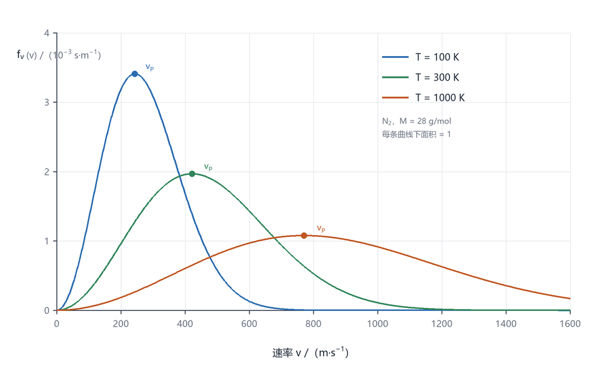
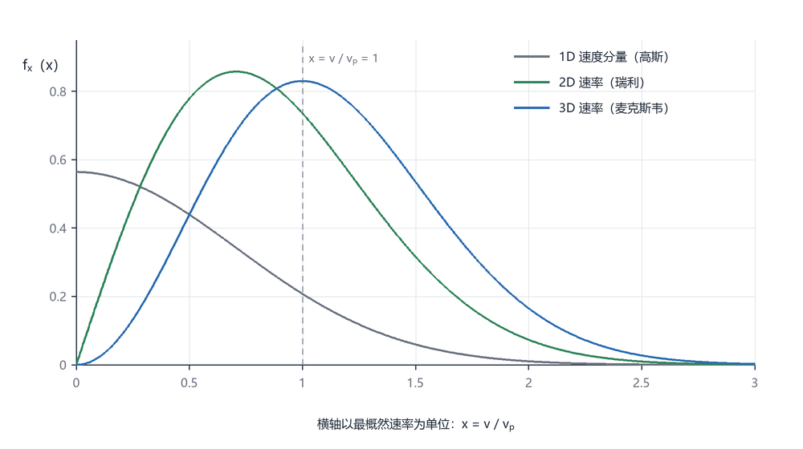

# 麦克斯韦速率分布：从玻尔兹曼因子到三个特征速率

> 一句话：气体分子的速率分布**不是均匀的**，它是两股力量拔河的结果 ——
> 能量权重 $e^{-E/k_BT}$ 想把分子都拽到低速，相空间体积 $4\pi v^2\,dv$ 却在高速度处提供了更大的"地盘"。
> 两条曲线相乘，才有了那个偏斜的峰。

---

## 1. 出发点：玻尔兹曼因子

温度 $T$ 的平衡态下，分子处于能量 $E$ 的微观态的概率正比于

$$
P(E)\propto e^{-E/k_BT},\qquad E=\tfrac12 m v^2=\tfrac12 m\left(v_x^2+v_y^2+v_z^2\right)
$$

三个速度分量互相独立、各自服从高斯分布，乘起来就是速度**矢量**的分布：

$$
f(\mathbf v)\,d^3v=\left(\frac{m}{2\pi k_BT}\right)^{3/2}
\exp\!\left(-\frac{m v^2}{2k_BT}\right)d v_x\,d v_y\,d v_z
$$

这里 $m$ 是**单个分子**的质量，$k_B$ 是玻尔兹曼常数。指数上的 $3/2$ 来自三个方向各贡献一个 $\sqrt{m/2\pi k_BT}$。

---

## 2. 换成速率：多出来的那个 $4\pi v^2$

我们关心的通常是**速率** $v=\lvert\mathbf v\rvert$，不是方向。速率在 $v$ 到 $v+dv$ 之间的状态，在速度空间里占一个半径为 $v$、厚度为 $dv$ 的**球壳**，体积是 $4\pi v^2\,dv$。把方向积掉：

$$
f(v)=4\pi v^{2}\left(\frac{m}{2\pi k_BT}\right)^{3/2}
\exp\!\left(-\frac{m v^{2}}{2k_BT}\right)
$$

令 $a=\dfrac{m}{2k_BT}$，写成紧凑形式：

$$
f(v)=\frac{4}{\sqrt{\pi}}\,a^{3/2}v^{2}e^{-a v^{2}},
\qquad
\int_0^{\infty}f(v)\,dv=1
$$

归一化用到 $\displaystyle\int_0^\infty v^2 e^{-av^2}dv=\frac{\sqrt{\pi}}{4a^{3/2}}$。

> **要点**：$v^2$ 不是物理上的"偏好高速"，而是**几何上的球壳变大**。
> 1 维里没有这个因子，所以速度分量是标准高斯（图 2 的灰线）；2 维只多一个 $v$（瑞利分布，绿线）；
> 3 维才多一个 $v^2$（麦克斯韦分布，蓝线）。

---

## 3. 三个特征速率

对 $f(v)$ 求极值、求一阶矩、求二阶矩，得到三个都叫"典型速率"、但数值各不相同的量：

$$
v_{p}=\sqrt{\frac{2k_BT}{m}}=\sqrt{\frac{2RT}{M}},
\qquad
\bar v=\sqrt{\frac{8k_BT}{\pi m}}=\sqrt{\frac{8RT}{\pi M}},
\qquad
v_{\mathrm{rms}}=\sqrt{\frac{3k_BT}{m}}=\sqrt{\frac{3RT}{M}}
$$

（$M$ 是摩尔质量，$R=N_Ak_B$。）

推导只用三条积分 / 求导：

$$
\frac{d}{dv}\left(v^{2}e^{-av^{2}}\right)=2v\left(1-av^{2}\right)e^{-av^{2}}=0
\;\Longrightarrow\;
v_{p}=\frac{1}{\sqrt a}
$$

$$
\int_0^\infty v^{3}e^{-av^{2}}dv=\frac{1}{2a^{2}},
\qquad
\int_0^\infty v^{4}e^{-av^{2}}dv=\frac{3\sqrt{\pi}}{8a^{5/2}}
$$

三者之比与温度、气体种类**都无关**，是一个纯数字：

$$
v_{p}:\bar v:v_{\mathrm{rms}}=1:\sqrt{\frac{4}{\pi}}:\sqrt{\frac{3}{2}}=1:1.128:1.225
$$

### 数值表（$R=8.314\ \mathrm{J\,mol^{-1}K^{-1}}$）

| 气体 | 温度 | $v_p$ (m/s) | $\bar v$ (m/s) | $v_{\mathrm{rms}}$ (m/s) |
|---|---|---|---|---|
| N₂（28 g/mol） | 100 K | 244 | 275 | 298 |
| N₂ | 300 K | 422 | 476 | 517 |
| N₂ | 1000 K | 771 | 869 | 944 |
| H₂（2 g/mol） | 300 K | 1573 | 1775 | 1927 |

同一温度下，H₂ 的速率是 N₂ 的 $\sqrt{14}\approx3.7$ 倍 —— 因为 $v\propto M^{-1/2}$。

---

## 4. 图像：升温到底改变了什么



*图 1　N₂ 在 100 K、300 K、1000 K 的速率分布（横轴 m/s，纵轴 $f(v)$，单位 $10^{-3}\,\mathrm{s\,m^{-1}}$）。圆点是各自的最概然速率 $v_p$。*

升温做两件事：**峰往右跑**（$v_p\propto\sqrt T$），同时**峰变矮**（$f_{\max}\propto T^{-1/2}$）。这两件事必须同时发生，因为曲线下面积恒为 1 —— 分布被"摊平"了，而不是整体平移。

> 注意别把 $T^{-1/2}$ 和 $T^{-3/2}$ 搞混：$T^{-3/2}$ 是**归一化常数**（前面那个 $\left(m/2\pi k_BT\right)^{3/2}$）的温度标度，不是峰高。
> 峰高要把 $v=v_p$ 代进去：$f(v_p)=\frac{4}{\sqrt\pi}a^{3/2}\cdot\frac{1}{a}\cdot e^{-1}=\frac{4}{\sqrt\pi}e^{-1}\sqrt a\propto T^{-1/2}$。
> 宽度 $\propto v_p\propto T^{1/2}$，高 $\propto T^{-1/2}$，乘起来恰好守恒。

一个常被忽略的后果：**升温后高速尾部的分子数暴涨**。别看 $v\approx3v_p$ 处的概率密度还是很小，它随温度的相对增长是压倒性的 —— 这就是阿伦尼乌斯因子 $e^{-E_a/k_BT}$ 的来源。



*图 2　同一温度下，1 维速度分量（高斯）、2 维速率（瑞利）、3 维速率（麦克斯韦）的对比，横轴以 $v_p$ 为单位。三条曲线面积都是 1。*

三种分布的峰位置：

- 1 维速度分量：峰在 $v=0$（最可能"静止"，因为能量最低）；
- 2 维速率：峰在 $v_p/\sqrt2\approx0.707\,v_p$；
- 3 维速率：峰在 $v_p$（$v^2$ 因子把峰往外推）。

**同一个 $v_p$ 定义，在 2 维和 3 维下给出不同的峰位** —— 这提醒我们：$v_p$ 是"对哪个分布求极值"的产物，不是气体的固有速度。

---

## 5. 换成能量：麦克斯韦–玻尔兹曼分布

$E=\frac12 mv^2$，$dE=mv\,dv$，代进去：

$$
f(E)\,dE=\frac{2}{\sqrt{\pi}}\,\frac{1}{\left(k_BT\right)^{3/2}}\sqrt{E}\,e^{-E/k_BT}\,dE
$$

峰位在 $E=\frac12 k_BT$，而平均平动动能是 $\langle E\rangle=\frac32 k_BT$ —— 又一次"峰位 ≠ 平均值"，和 $v_p<\bar v$ 是同一件事的两种表现。

---

## 6. 常见误区

| 误区 | 问题所在 |
|---|---|
| "$f(v)$ 是高斯分布" | 不是。高斯是 $e^{-av^2}$，麦克斯韦多一个 $v^2$，所以右边拖尾、峰值不移到 0 |
| "$v_p=\bar v=v_{\mathrm{rms}}$" | 差 12%–22%，做估算时混用会直接错一档 |
| "升温后慢分子变多" | 峰右移，密度在低速率端是**下降**的；变多的是高速尾部 |
| "任何情况下都用 3 维公式" | 表面吸附、二维电子气用 2 维（瑞利）；分子束某一方向用 1 维 |
| "经典分布永远成立" | 只在 $n\lambda_T^3\ll1$ 时成立，其中 $\lambda_T=h/\sqrt{2\pi mk_BT}$；低温高密度要换费米–狄拉克或玻色–爱因斯坦 |
| "$\bar v$ 就是平均速度" | 平均**速度**是矢量，等于零；$\bar v$ 是平均**速率** |

---

## 7. 和实验的接口

1. **分子束速度选择**：Stern（1920）与 Zartman–Ko（1930）用旋转的槽盘筛出特定速率的分子，直接测出分布形状；现代版本是时间飞行谱（TOF）。
2. **多普勒展宽**：谱线宽度 $\Delta\nu/\nu\sim v/c$，测到的线型就是速率分布在该方向的投影（1 维高斯）。
3. **大气逃逸**：$v>v_{\mathrm{esc}}$ 的分子逃离重力井，积分的是分布的高能尾部 —— 氢氦先跑、重气体留下。
4. **化学反应速率**：只有 $E>E_a$ 的分子能反应，速率常数是尾部的积分，结果就是阿伦尼乌斯公式。

---

## 8. 本文数值的自查

本页所有数字由 `../scripts/plot_maxwell.py` 现场算、现场验证（脚本里带 `--check`）：

```
归一化 ∫f3 dv        = 1.000000000
峰值 v_peak          = 421.99 m/s   （解析 v_p = 421.99）
∫v f3 dv             = 476.17 m/s   （解析 v_mean = 476.17）
√(∫v² f3 dv)         = 516.83 m/s   （解析 v_rms = 516.83）
归一化 2D / 1D       = 0.999999999 / 1.000000000
```

四种验证各自堵住一类错误：面积堵归一化系数，峰值堵 $a$ 的系数（$m$ vs $M$、$2$ vs $1$），一阶矩和二阶矩堵 $\pi$ 与 $\sqrt{}$ 的位置。

---

*图与数字均由 `../scripts/plot_maxwell.py` 生成；公式经 KaTeX 逐条编译校验。*
